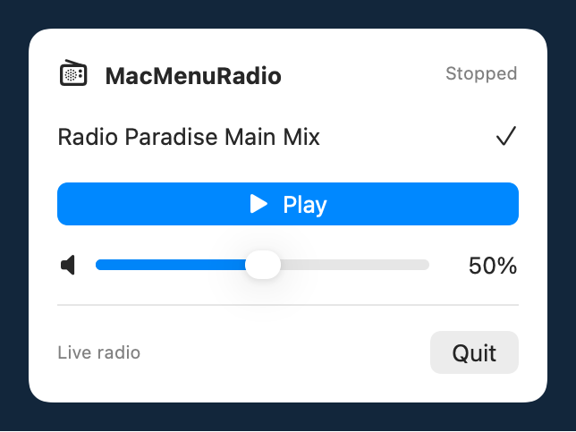

<p align="center">
  
</p>

# MacMenuRadio

A small native macOS menu bar radio player built with SwiftUI and AVFoundation.

Choose a station, press Play, and adjust the volume beside the clock. The app remembers your station and volume between launches. Playback starts when you press Play.

<p align="center">
  
</p>

The image is rendered from the production SwiftUI controls in their stopped state.

## Features

- Configurable stations with Radio Paradise Main Mix included
- Play and Stop controls
- Volume slider with percentage display
- Playback status, connection timeout, and error messages
- Saved station and volume preferences
- Native Apple audio playback with no third-party package dependencies

## Preconditions

| Task | Requirements |
| --- | --- |
| Run a built app | macOS 13 or later, an Apple Silicon or Intel Mac, internet access to the station, and an audio output |
| Build from source | A Mac with Xcode or Xcode Command Line Tools providing Swift 6 and a macOS SDK |
| Share a downloadable release | Developer ID signing and Apple notarization for normal Gatekeeper distribution |

To use the built app, double-click `MacMenuRadio.app` in Finder. Terminal and Apple's developer tools are needed to build it from source.

The build uses the macOS-provided `/bin/sh` and Apple's developer tools. A stock Mac needs developer tools installed before it can compile source. The current build creates a locally signed development app. Downloadable builds still need Developer ID signing and notarization before publication. [Apple's distribution guidance](https://developer.apple.com/documentation/security/notarizing-macos-software-before-distribution)

## Build and run

From the repository folder, run the following commands.

```sh
/bin/sh ./build.sh
open "build/MacMenuRadio.app"
```

The script builds a universal executable containing arm64 and x86_64 versions. You can drag the built app into Applications, then launch it from Finder.

Click the radio icon beside the clock. Select a station and press Play. Switching stations during playback starts the selected station. Stop releases the stream connection. Quit exits the app.

## Configure stations

The default example is Radio Paradise Main Mix, a publicly available station that publishes links for external players. Its broadcasts remain subject to the provider's terms and copyright. The project's MIT license covers the player code and documentation. [Radio Paradise stream links](https://radioparadise.com/listen/stream-links)


Copy the shared template to your personal configuration, then edit the copy.

```sh
cp -n stations.json.example stations.json
```

`stations.json` is ignored by Git. Keep personal stations and any private URLs in that file. Changes to the shared example belong in `stations.json.example`.

The build bundles your personal file when it exists and otherwise uses the example. Both become `stations.json` inside the app bundle. Builds made with personal settings include those settings in the resulting app, so use a clean checkout with only the example for public releases.

For an installed app, create the following file in your home folder and restart the app.

```text
~/Library/Application Support/MacMenuRadio/stations.json
```

You can use Finder's Go → Go to Folder to open `~/Library/Application Support`, create a folder named `MacMenuRadio`, and copy your personal `stations.json` into it. To start with the shared defaults, copy `stations.json.example` and name the destination file `stations.json`.


The user file replaces the complete bundled list. The app reads it at launch. Each entry needs a stable, unique `id`, a nonempty `name`, and an absolute HTTPS stream `url`.

```json
[
  {
    "id": "radio-paradise-main",
    "name": "Radio Paradise Main Mix",
    "url": "https://stream.radioparadise.com/aac-128"
  }
]
```

Keep an ID unchanged when renaming a station to preserve the saved selection. If the saved station is removed, the app selects the first entry. Invalid configuration displays an error and disables Play until you fix the file and restart. Delete the user file to return to bundled defaults.

Support for a URL depends on AVPlayer and the provider's availability. Use direct audio streams or supported HLS streams.

<details>
<summary>Set up MacMenuRadio with a coding agent</summary>

Copy this prompt into your coding agent and replace the station list with your names and direct HTTPS streaming URLs. Supply one or more stations and remove unused placeholder lines.

```text
Set up MacMenuRadio from https://github.com/roygrssmn/MacMenuRadio on my Mac.
Use an existing checkout if available. Read its README and contribution guidance.

My stations are
- Radio Paradise Main Mix | https://stream.radioparadise.com/aac-128
- <station name> | <direct HTTPS audio stream URL>
- <another station name> | <direct HTTPS audio stream URL>

Use only the stations I supply. Ask me for missing URLs and skip placeholder lines.
Create stable, unique station IDs. Put my list in the Git-ignored stations.json
and in the app's user configuration at
~/Library/Application Support/MacMenuRadio/stations.json.
Inspect existing configuration and symlinks first, and preserve the existing
configuration before replacing it. Keep stations.json.example as the shared
public template.

Check macOS and Swift build prerequisites. Run /bin/sh ./check.sh and
/bin/sh ./build.sh. Install the built app in my user Applications folder and
open it so I can select a station and test playback.

If shared code or documentation needs changes, use a feature branch, review
the staged diff, and commit only those shared changes with a descriptive message.
Exclude stations.json, personal URLs, credentials, build outputs, and user
configuration backups from every commit and pull request.
Verify git check-ignore stations.json succeeds and git ls-files stations.json
prints nothing before committing. If only my personal settings changed,
leave the repository without a new commit. Do not push.
Report the installed app location and the checks that actually passed.
```

</details>

## Implementation

SwiftUI's MenuBarExtra hosts the controls. AVPlayer handles decoding, buffering, and audio output. UserDefaults stores the selected station ID and volume.

The app observes playback and item status. Stream completion and failure events update the controls. Events from an old stream are ignored after switching stations. A connection that remains pending for 30 seconds stops with an error.

| File | Purpose |
| --- | --- |
| MacMenuRadio.swift | Playback state and menu bar controls |
| Stations.swift | Configuration loading and validation |
| stations.json.example | Shared default station template |
| stations.json | Personal station list, ignored by Git |
| Info.plist | App metadata and menu bar utility configuration |
| build.sh | Universal compilation, resources, and local signing |
| check.sh and Tests/ | Configuration and player recovery regression checks |
| .github/workflows/ci.yml | Runs checks and a universal build on GitHub Actions |

## Verification and limitations

Run the configuration and player recovery checks with the following command.

```sh
/bin/sh ./check.sh
```

GitHub Actions runs the checks and universal build on Apple Silicon and Intel macOS runners for pushes and pull requests. CI also rejects a tracked `stations.json`. The workflow has read-only repository permissions and uses offline player checks. A successful workflow run is required to confirm behavior on those hosted runners.

The Radio Paradise example stream played through AVPlayer during a muted test on Apple Silicon. Earlier diagnostic checks exercised station switching, volume changes, stopping, saved preferences, and simulated disconnection.

The build targets macOS 13 or later. Runtime testing has been on macOS 27.2 with Apple Silicon. Intel hardware and macOS 13 runtime testing remain outstanding. UI automation timed out during the initial implementation, so manual interaction checks, extended playback, and sleep/wake behavior remain outstanding.

After a failed or ended stream, press Play to reconnect. Every playback attempt uses a fresh AVPlayer, including after a terminal player failure. Recovery checks simulate a stream failure and verify fresh-player identity and cleanup. An actual macOS media-service failure has not been reproduced.

## License and contributors

Created and maintained by Roy Grossman. [grossman.engineering](https://grossman.engineering)

The project uses the MIT license, chosen to allow reuse with copyright and license notices preserved. See [LICENSE](LICENSE), [contributors](CONTRIBUTORS.md), and [contribution guidance](CONTRIBUTING.md).

Read the [privacy information](PRIVACY.md) and [stream and third-party notices](NOTICE.md) for local storage and broadcaster rights.
